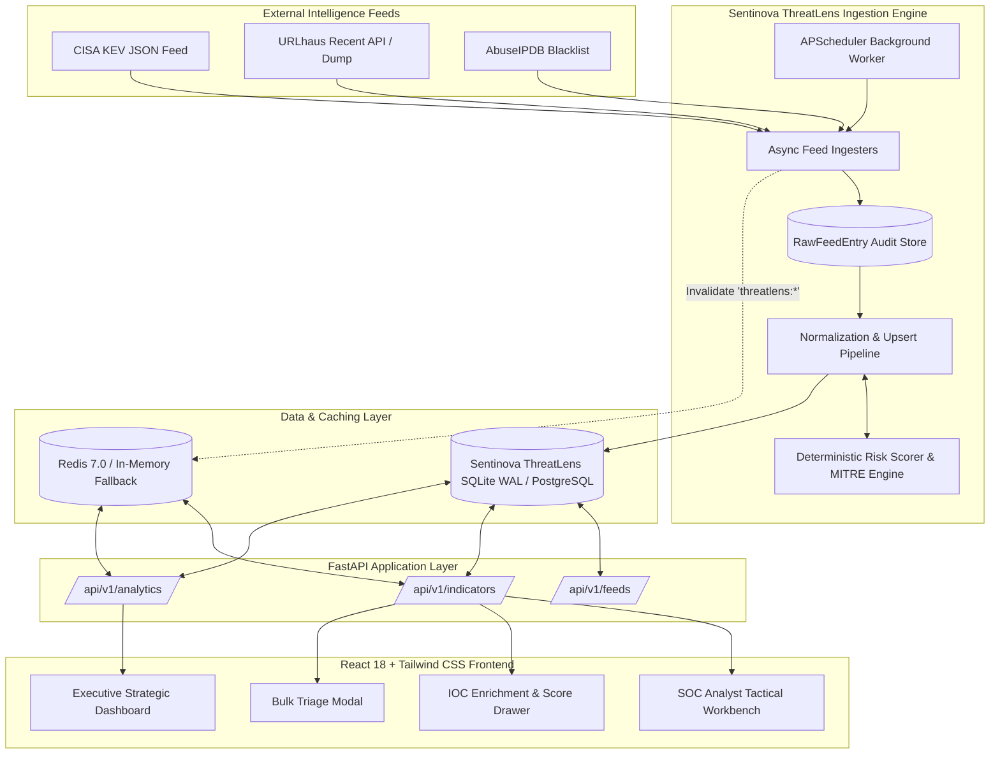
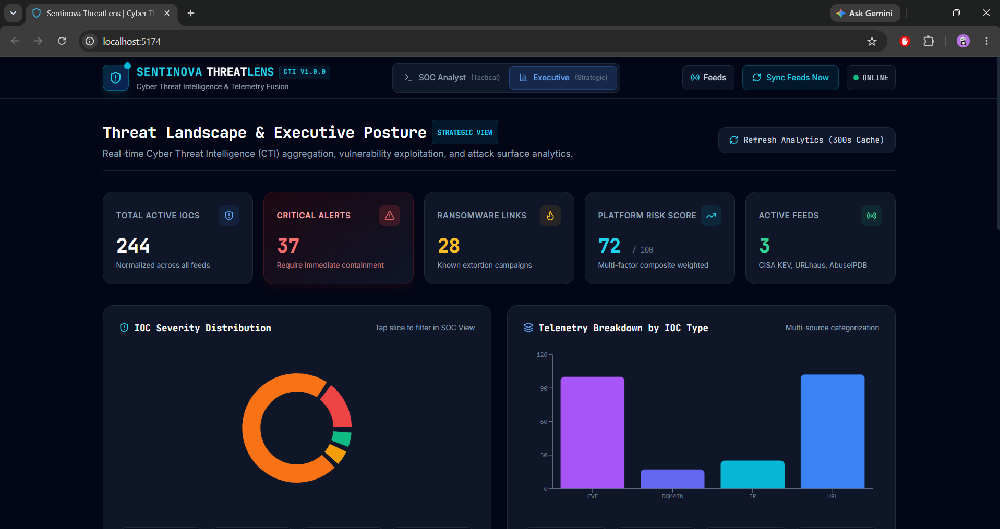
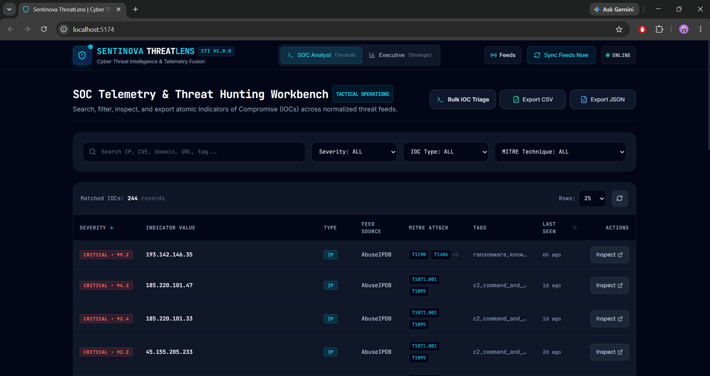

# 🛡️ Sentinova ThreatLens — Cyber Threat Intelligence (CTI) Platform

[](https://www.python.org/)
[](https://fastapi.tiangolo.com/)
[](https://react.dev/)
[](https://tailwindcss.com/)
[](https://www.docker.com/)
[](LICENSE)

**Sentinova ThreatLens** is an enterprise-grade Cyber Threat Intelligence (CTI) aggregation, risk-scoring, and visualization platform. Designed specifically for security operations centers (SOCs) and cybersecurity leadership, Sentinova ThreatLens continuously ingests raw threat indicators from authoritative global feeds, normalizes them into atomic Indicators of Compromise (IoCs), executes an explainable multi-factor risk scoring engine, maps observables to the **MITRE ATT&CK® framework**, and serves both tactical analysts and executive stakeholders through a unified cyber-dark dual-mode interface.

---

## 📌 Table of Contents

- [Architectural Overview](#-architectural-overview)
- [Key Engineering Features](#-key-engineering-features)
- [System Architecture & Data Pipeline](#-system-architecture--data-pipeline)
- [Risk Scoring & MITRE Engine](#-risk-scoring--mitre-engine)
- [Technology Stack](#-technology-stack)
- [Repository Structure](#-repository-structure)
- [API Reference](#-api-reference)
- [Quick Start Guide](#-quick-start-guide)
  - [Option A: Docker Compose (Recommended)](#option-a-docker-compose-recommended)
  - [Option B: Local Native Execution](#option-b-local-native-execution)
- [Dashboard Walkthrough](#-dashboard-walkthrough)
- [Author & Security Profile](#-author--security-profile)

---

## 🏛️ Architectural Overview

Sentinova ThreatLens bridges the gap between raw threat telemetry and operational cyber defense. Threat intelligence feeds frequently output unstructured, unranked, and duplicate data that overwhelms SOC tier-1 analysts. Sentinova ThreatLens solves this via:

1. **Autonomous Feed Ingestion**: Asynchronously harvests indicators across CISA Known Exploited Vulnerabilities (KEV), URLhaus (malware distribution and C2), and AbuseIPDB (malicious IPs and brute-force scanners).
2. **Deterministic Natural Deduplication**: Upserts records onto natural composite keys `(value, ioc_type)`, tracking recency decay and merging threat context.
3. **Explainable Composite Risk Scoring**: Calculates deterministic scores (0.0 to 100.0) with mathematical breakdowns across source reliability, threat context, and temporal recency decay.
4. **Resilient Hybrid Caching**: Integrates Redis with automatic, zero-crash in-memory TTL dictionary fallback.
5. **Dual-Mode SOC Workbench**: Instant toggle between an **Executive Strategic Landscape** (high-level risk posture, KPIs, MITRE matrices, vendor exposure) and a **SOC Analyst Tactical Workbench** (sub-second queries, bulk triage, SIEM CSV/JSON exports, and enrichment drawers).

---

## ⚡ Key Engineering Features

- **High-Concurrency SQLite WAL & Async Engine**: Configured with Write-Ahead Logging (`journal_mode=WAL`, `synchronous=NORMAL`) ensuring concurrent feed ingestion writes never lock read requests from API analysts.
- **MITRE ATT&CK® Correlation**: Automatically correlates incoming indicator tags and exploit flags to standardized technique identifiers (e.g., `T1190` Exploit Public-Facing Application, `T1105` Ingress Tool Transfer, `T1486` Data Encrypted for Impact).
- **Sub-Second Bulk Triage**: Paste up to 50 arbitrary IPs, CVEs, domains, or URLs to instantly triage known campaign assets versus clean observables.
- **SIEM Interoperability**: One-click streaming exports of filtered threat indicators in RFC 4180 compliant CSV or structured JSON for ingestion into Splunk, Microsoft Sentinel, or Elastic Security.
- **Zero-Downtime Cache Resiliency**: Employs an asynchronous facade (`app/services/cache.py`) that transparently falls back to an in-memory TTL dictionary if Redis is unreachable. Ingestion updates automatically invalidate all `threatlens:*` cache namespaces.

---

## 🔄 System Architecture & Data Pipeline



---

## 🧮 Risk Scoring & MITRE Engine

The Sentinova ThreatLens scoring algorithm calculates an audit-ready, explainable composite score:

$$\text{Composite Score} = (\text{Source Weight} \times 0.40) + (\text{Context Bonus} \times 0.35) + (\text{Recency Factor} \times 25.0)$$

### 1. Factor Weights

| Component | Weight | Max Points | Description |
|---|---|---|---|
| **Source Reliability** | 40% | 40.0 pts | Base feed credibility (CISA KEV: 95.0, URLhaus: 80.0, AbuseIPDB: dynamic confidence scale 0–100). |
| **Context & Threat Type** | 35% | 35.0 pts | Threat severity multiplier: Ransomware (100.0), C2 / Command & Control (85.0), Payload Download (65.0), Exploit (55.0), Phishing (45.0), Brute Force (25.0), Scanner (15.0). |
| **Recency Factor** | 25% | 25.0 pts | Linear temporal decay over a 45-day window. Telemetry within 24 hours yields full 25.0 points. |

### 2. Severity Classification Thresholds

- 🔴 **CRITICAL** ($\ge 85.0$): Known exploited ransomware vectors, active Cobalt Strike C2s, high-confidence malicious infrastructure.
- 🟠 **HIGH** ($65.0 - 84.9$): Standard KEV catalog exploits, verified Trojan loaders, active botnet distribution nodes.
- 🟡 **MEDIUM** ($40.0 - 64.9$): Phishing portals, credential harvesters, moderate-confidence scanning hosts.
- 🟢 **LOW** ($< 40.0$): Reconnaissance probes, unverified telemetry, low-confidence network noise.

---

## 💻 Technology Stack

| Layer | Technologies | Key Highlights |
|---|---|---|
| **Backend Runtime** | Python 3.14 / 3.12, FastAPI, Uvicorn (ASGI) | Async I/O, PEP 649/749 typing, high throughput |
| **ORM & Database** | SQLAlchemy 2.1, SQLite 3 (WAL mode), Alembic | Mapped declarative annotations, crash-resilient batch commits |
| **Scheduling** | APScheduler 3.10 | Non-blocking async interval job runner |
| **Caching Layer** | Redis 7.0 + In-Memory TTL Dict Fallback | Automatic fallback on connection drop, prefix invalidation |
| **Frontend Framework** | React 18, Vite 6 | Fast HMR, optimized Rollup bundling |
| **Styling & Icons** | Tailwind CSS 3.4, Lucide React | Cyber dark SOC aesthetic (`bg-slate-950`), responsive design |
| **Data Visualization** | Recharts 2.15 | Custom dark-mode tooltips, interactive donut & bar charts |
| **Containerization** | Docker, Docker Compose, Nginx Alpine | Multi-stage production build, isolated bridge network |

---

## 📂 Repository Structure

```text
Sentinova-ThreatLens/
├── docker-compose.yml              # Production container orchestration
├── README.md                       # Architecture & deployment documentation
├── backend/
│   ├── Dockerfile                  # Python 3.12-slim backend container
│   ├── requirements.txt            # Pinned production Python dependencies
│   ├── .dockerignore               # Container build exclusions
│   ├── .env.example                # Configuration template
│   ├── test_phase3.py              # End-to-end backend test & calibration suite
│   └── app/
│       ├── __init__.py
│       ├── config.py               # Pydantic v2 BaseSettings environment loader
│       ├── database.py             # SQLite WAL engine & SessionLocal factory
│       ├── main.py                 # FastAPI application, lifespan & router mounting
│       ├── models/
│       │   ├── __init__.py
│       │   └── threat.py           # Indicator, Feed, and RawFeedEntry ORM models
│       ├── schemas/
│       │   ├── __init__.py
│       │   └── threat.py           # Pydantic validation schemas & API contracts
│       ├── services/
│       │   ├── __init__.py
│       │   ├── cache.py            # Resilient async caching with in-memory fallback
│       │   ├── ingester.py         # Async CISA KEV, URLhaus, AbuseIPDB ingesters
│       │   ├── normalizer.py       # Deduplication, upsert & normalization pipeline
│       │   ├── scheduler.py        # Background ingestion orchestration
│       │   └── scorer.py           # 3-factor composite risk engine & MITRE mapper
│       └── routers/
│           ├── __init__.py
│           ├── analytics.py        # Executive KPI & threat landscape analytics
│           ├── feeds.py            # Feed telemetry, health & manual sync triggers
│           └── indicators.py       # SOC filterable IOC table, lookup & SIEM export
└── frontend/
    ├── Dockerfile                  # Multi-stage Node.js + Nginx Alpine build
    ├── nginx.conf                  # Static SPA server & /api/ reverse proxy
    ├── package.json                # React 18, Vite, Tailwind, Recharts dependencies
    ├── vite.config.js              # Vite dev server with /api proxy to localhost:8000
    ├── tailwind.config.js          # Cyber dark design system tokens
    ├── postcss.config.js
    ├── index.html                  # HTML entrypoint with JetBrains Mono & Inter
    └── src/
        ├── App.jsx                 # View state coordinator, drawer & modal manager
        ├── index.css               # Tailwind base directives & custom cyber scrollbars
        ├── main.jsx                # React StrictMode root entrypoint
        ├── components/
        │   ├── Navbar.jsx          # Dual-mode switcher, backend liveness & sync button
        │   ├── IndicatorDrawer.jsx # Slide-over score breakdown & MITRE inspector
        │   ├── BulkLookupModal.jsx # 50-item batch IOC triage modal
        │   └── FeedStatusModal.jsx # Feed health registry and telemetry viewer
        ├── pages/
        │   ├── AnalystView.jsx     # SOC Tactical Workbench with pagination & export
        │   └── ExecutiveView.jsx   # Strategic CTI posture with Recharts visualizations
        └── services/
            └── api.js              # Centralized Axios client for all backend routes
```

---

## 📡 API Reference

All routes are mounted under the `/api/v1` namespace.

| Method | Endpoint | Description | Key Query / Body Parameters |
|---|---|---|---|
| `GET` | `/api/v1/health` | Liveness and version verification | — |
| `GET` | `/api/v1/analytics/executive-summary` | 300s cached executive KPIs and landscape metrics | — |
| `GET` | `/api/v1/indicators` | Paginated, filterable, and sortable IOC table | `page`, `page_size`, `severity`, `ioc_type`, `mitre_technique`, `search`, `sort_by`, `sort_order` |
| `GET` | `/api/v1/indicators/lookup` | Single IOC enrichment with transparent score breakdown | `q` (e.g. `?q=193.142.146.35` or `?q=CVE-2024-21887`) |
| `POST` | `/api/v1/indicators/bulk-lookup` | Batch triage up to 50 raw indicators | `{"indicators": ["1.1.1.1", "CVE-2023-1234"]}` |
| `GET` | `/api/v1/indicators/export` | Stream filtered indicators in CSV or JSON | `format` (`csv` or `json`), plus all table filters |
| `GET` | `/api/v1/feeds/` | Registered feed status, telemetry health, ingested counts | — |
| `POST` | `/api/v1/feeds/sync` | Trigger immediate ingestion sync and purge cache | — |

Interactive Swagger documentation is available at `http://localhost:8000/api/v1/docs`.

---

## 🚀 Quick Start Guide

### Option A: Docker Compose (Recommended)

Run the entire stack (FastAPI Backend, Redis Caching, Nginx React Frontend) with a single command:

```bash
# Clone the repository
git clone https://github.com/your-username/sentinova-threatlens.git
cd sentinova-threatlens

# Launch all containers
docker compose up --build -d
```

- **Frontend Application**: `http://localhost:5173`
- **FastAPI Documentation**: `http://localhost:8000/api/v1/docs`
- **Backend Healthcheck**: `http://localhost:8000/api/v1/health`

To stop the containers:
```bash
docker compose down
```

---

### Option B: Local Native Execution

#### 1. Backend Setup (PowerShell / Windows)

```powershell
cd backend

# Create and activate virtual environment
python -m venv .venv
.\.venv\Scripts\Activate.ps1

# Install pinned dependencies
pip install -r requirements.txt

# Run backend test & dry-run sync
python test_phase3.py

# Launch FastAPI development server
uvicorn app.main:app --reload --host 127.0.0.1 --port 8000
```

#### 2. Frontend Setup (Separate Terminal)

```powershell
cd frontend

# Install Node dependencies
npm install

# Start Vite dev server with proxy to port 8000
npm run dev
```

Navigate to `http://localhost:5173` in your browser.

---

## 🖥️ Dashboard Walkthrough

### 1. Executive Strategic Landscape
- **Real-Time KPIs**: Total IOC inventory, active critical alerts, ransomware-linked CVEs, platform composite risk score, and healthy telemetry feeds.
- **Severity Donut**: Interactive breakdown of `CRITICAL`, `HIGH`, `MEDIUM`, and `LOW` indicators. Clicking any segment automatically transitions the analyst to the filtered tactical table.
- **MITRE ATT&CK Matrix**: Observed technique volume distribution (`T1190`, `T1105`, `T1486`, `T1071.001`, `T1110`).
- **Targeted Vendors & Origin Countries**: Surface CISA KEV vendor concentrations and geo-origin distribution.

### Strategic Executive View
> High-level telemetry KPIs, severity distributions, top targeted vendors, and threat origin analytics.


### 2. SOC Analyst Tactical Workbench
- **Sub-Second Multi-Filtering**: Full-text debounced search across values, threat types, and tags; filterable by severity, IoC type, and MITRE technique.
- **Bulk IOC Triage Modal**: Ingests up to 50 observables pasted from incident tickets or SIEM alerts, partitioning them into known malicious indicators vs. clean items.
- **Slide-Over Enrichment Drawer**: Click any indicator to inspect transparent scoring progress bars, deep links to MITRE ATT&CK documentation, related attack campaign assets, and raw JSON telemetry.
- **SIEM Export**: Instant CSV and JSON downloads preserving active filter criteria for firewall or EDR blocklist deployment.

### Tactical SOC Analyst Workbench
> Real-time threat hunting, multi-parameter filtering, atomic IOC lookup, and SIEM exports.


---

## 👨‍💻 Author & Security Profile

**Sentinova ThreatLens** was engineered by **Abhijeet Sharma** as a demonstration of production-grade Cyber Threat Intelligence engineering, deterministic risk analysis, and full-stack cybersecurity application architecture.

- **Focus Areas**: Cyber Threat Intelligence (CTI), Detection Engineering, Threat Hunting, Full-Stack Python/React Systems.
- **Connect**: [LinkedIn](https://linkedin.com) • [GitHub](https://github.com) • [Security Portfolio](https://github.com)

---

*Sentinova ThreatLens is distributed under the MIT License.*
